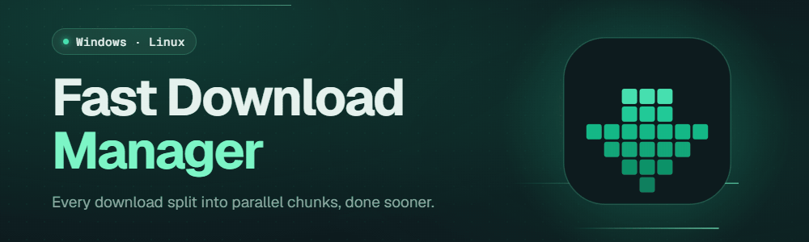

  

  <b>Every download split into parallel chunks, done sooner.</b> 
  Fast downloads and one-click video capture from your browser, on Windows and Linux.

  
  
  

  <a href="https://fdm.naz.ovh">Website</a> ·
  <a href="https://fdm.naz.ovh/docs/guide/">User guide</a> ·
  <a href="changelog/">Changelog</a> ·
  <a href="https://github.com/Naz-Ovh/Fast-Download-Manager/issues">Report a problem</a>

## Download

Get the file for your system from the **[latest release](https://github.com/Naz-Ovh/Fast-Download-Manager/releases/latest)**.

| System | File | Install |
| --- | --- | --- |
| **Windows** 10 / 11 (x64) | `.msi` | Open it and choose *Just me* or *Everyone*. |
| **Linux**, any distribution | `.run` | `sh FastDownloadManager-*.run` |
| **Debian / Ubuntu** | `.deb` | `sudo apt install ./fast-download-manager_*.deb` |
| **Arch Linux** | `.pkg.tar.zst` | `sudo pacman -U fast-download-manager-*.pkg.tar.zst` |
| **macOS** | — | Coming later |

Then add the **[browser extension](https://fdm.naz.ovh/docs/guide/browser-extension/)** to send downloads and
videos to the app.

## Supported

| | |
| --- | --- |
| **Systems** | Windows 10 and 11 (x64) · Linux x86_64 (Wayland, glibc 2.31 or newer) |
| **Browsers** | Chrome · Edge · Brave · Firefox |
| **Downloads** | HTTP and HTTPS, up to 32 connections per file, pause and resume, automatic retries, speed limit |
| **Video** | HLS (AES-128 too) and DASH streams; video and audio merged into MP4 or MKV, no extra tools |
| **Subtitles** | Added to the video as a track, or saved as `.srt` |
| **Languages** | 39, with right-to-left layouts |

## Roadmap

- **Queues and scheduler:** start and stop times, and what to do when done.
- **Download all links** from a page, and batch downloads.
- **Site grabber** and **clipboard monitoring**.
- **FTP, SOCKS proxies and site logins.**
- **Options window** for every setting.
- **macOS** app, and **.rpm** and **AppImage** for Linux.
- **Browser stores:** one-click install of the extension.
- **BitTorrent and magnet links.**

The full list: [Roadmap](https://fdm.naz.ovh/docs/guide/roadmap/).

## Docs

| | |
| --- | --- |
| [Getting started](https://fdm.naz.ovh/docs/guide/) | What the app does, in three steps |
| [Install](https://fdm.naz.ovh/docs/guide/install/) | Setup on Windows and Linux |
| [Browser extension](https://fdm.naz.ovh/docs/guide/browser-extension/) | Add it to your browser |
| [Downloading](https://fdm.naz.ovh/docs/guide/downloading/) | Add, pause, resume and sort downloads |
| [Video](https://fdm.naz.ovh/docs/guide/video/) | Save the video on a page |
| [Settings](https://fdm.naz.ovh/docs/guide/settings/) | Connections, folders, language and theme |
| [Command line](https://fdm.naz.ovh/docs/guide/cli/) | Start downloads from scripts |
| [Troubleshooting](https://fdm.naz.ovh/docs/guide/troubleshooting/) | When something does not work |
| [FAQ](https://fdm.naz.ovh/docs/guide/faq/) | Common questions |
| [Changelog](changelog/) | What changed in each version |

## Sponsors

  
  &nbsp;
  

  Want your logo here? <a href="https://github.com/Naz-Ovh/Fast-Download-Manager/issues/new?title=Sponsorship%20inquiry"><b>Contact us about sponsorship</b></a>.

